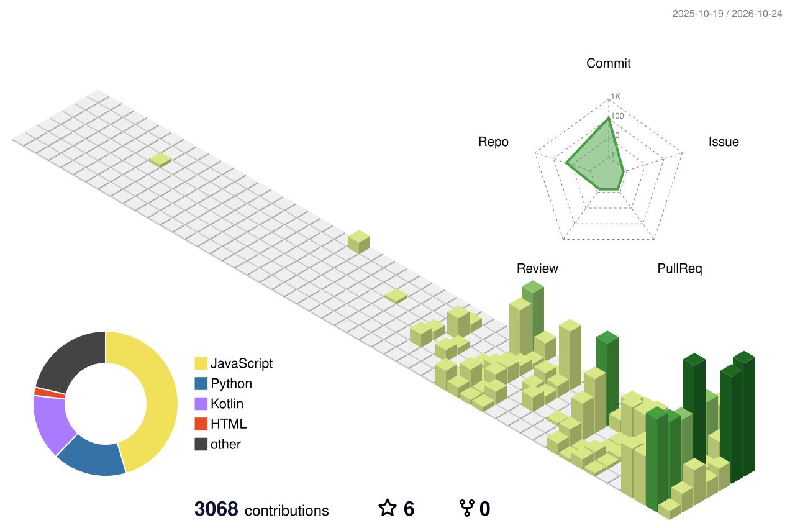

<div align="center">
  
</div>

Halo, saya Gopyr, mahasiswa Informatika di Universitas Gunadarma. Saya suka membangun tools kecil yang menjawab masalah nyata: dari payment gateway QRIS, dashboard benchmark, sync engine offline untuk Android, sampai toolkit security untuk VPS.

## Apa yang saya kerjakan

- **Pembayaran & storefront** — payment gateway QRIS di Vercel ([Gopayment-Vercel](https://github.com/Gopyr/Gopayment-Vercel)) dan toko digital yang memakainya ([Gopayment-Store](https://github.com/Gopyr/Gopayment-Store)), lengkap dengan order, stok, dan callback.
- **Developer tools** — [standup-report](https://github.com/Gopyr/standup-report) untuk laporan standup otomatis dari git history, [labboard](https://github.com/Gopyr/labboard) untuk membandingkan laporan benchmark, dan [tracelens](https://github.com/Gopyr/tracelens) sebagai proxy observability lokal.
- **Android & sync** — [vclass-sync](https://github.com/Gopyr/vclass-sync), offline-first sync engine Kotlin dengan queue tahan backoff, plus [Vclass-App](https://github.com/Gopyr/Vclass-App), aplikasi pendamping V-Class Gunadarma berbasis Jetpack Compose.
- **Security & infrastruktur** — [autorecon](https://github.com/Gopyr/autorecon) untuk quick-audit headers/CORS/TLS, [Advanced-Layer-7-Stress-Test-Tool](https://github.com/Gopyr/Advanced-Layer-7-Stress-Test-Tool) untuk load test terotorisasi, dan fork [Nginx-Lua-Anti-DDoS](https://github.com/Gopyr/Nginx-Lua-Anti-DDoS).
- **Game modding** — [red-alert-modern-era](https://github.com/Gopyr/red-alert-modern-era), mod OpenRA Red Alert dengan 180+ unit perang modern dan sprite prosedural 8 arah.
- **AI agent skills** — [gopyr-skills-hub](https://github.com/Gopyr/gopyr-skills-hub), kumpulan 350+ skill terkurasi untuk autonomous agent.

## Tools favorit

```text
git, Node.js, Kotlin, Python, Nginx + Lua, React, Jetpack Compose, Vercel, OpenRA
```

<div align="center">
  
</div>

<div align="center">
  
</div>
