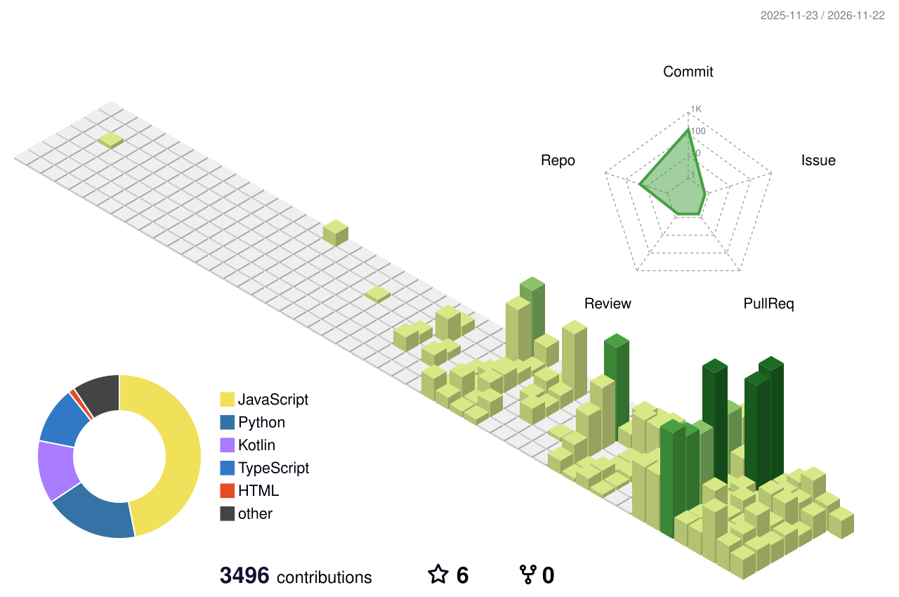

<div align="center">
  
</div>

<h1 align="center">Hi 👋, I'm Gopar (Gopyr)</h1>

<p align="center">
  
</p>

## 🧑‍💻 About

```js
const Gopar = {
  name: "Gopar",
  username: "Gopyr",
  country: "Indonesia",
  focus: ["Automation", "Bot Development", "Self-hosted Infrastructure"],
  languages: ["JavaScript", "Kotlin", "Python", "Go"],
  tools: ["Node.js", "Nginx + Lua", "Docker", "Cloudflare Tunnel"],
  funFact: "Runs a full workspace + VPS panel + bot empire from one dashboard"
};
```

## ⚡ Tech Stack

<p align="center">
  
</p>

## 📊 GitHub Stats

<div align="center">
  
  
</div>

<div align="center">
  
</div>

## 🐍 Contributions

<div align="center">
  
</div>

## 👁️ Visitors

<div align="center">
  
  <br/><br/>
  
</div>

## 📫 Reach Me

<div align="center">
  <a href="https://github.com/Gopyr"></a>
  <a href="https://naufalbs.my.id"></a>
</div>
